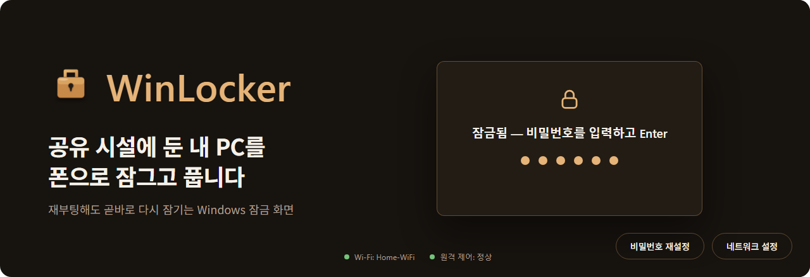
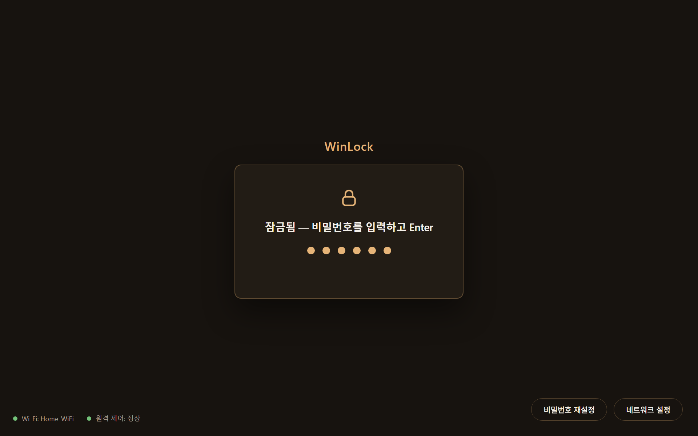
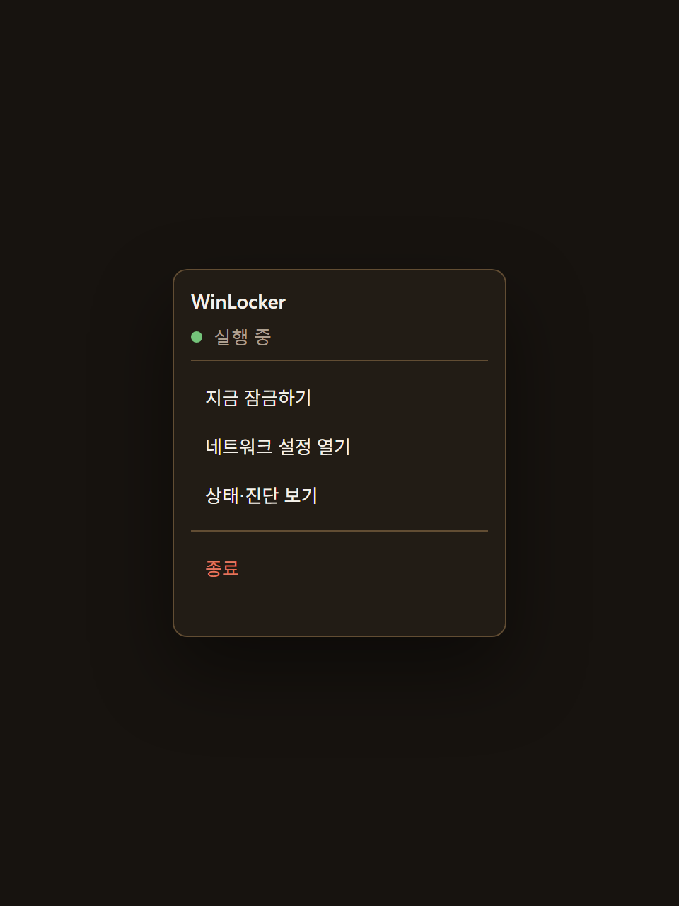
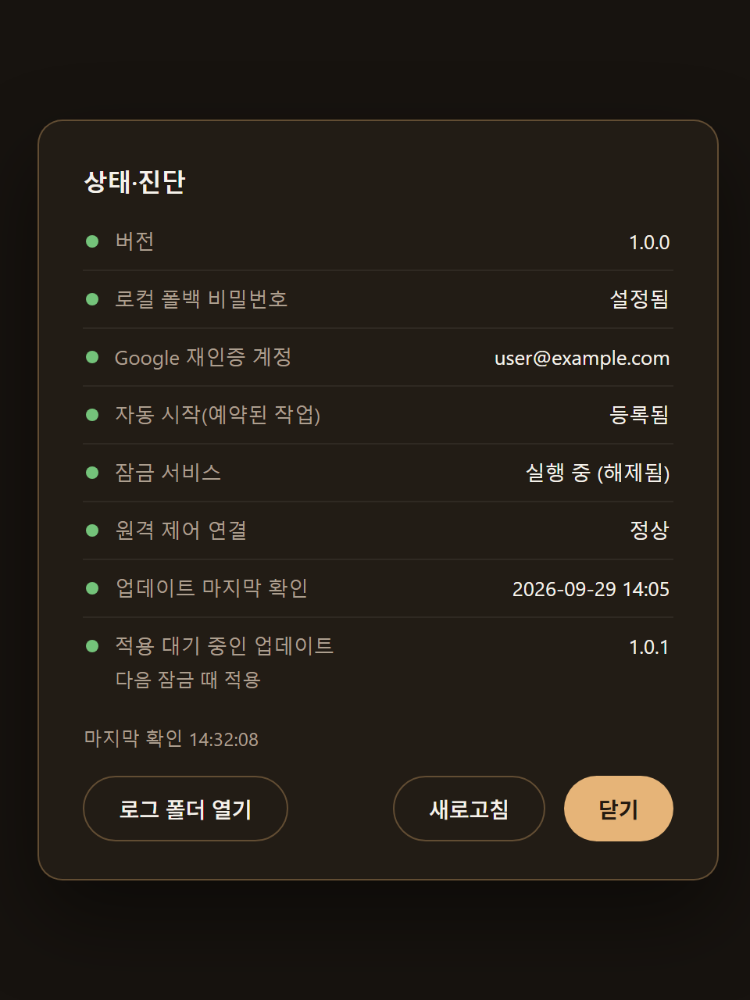
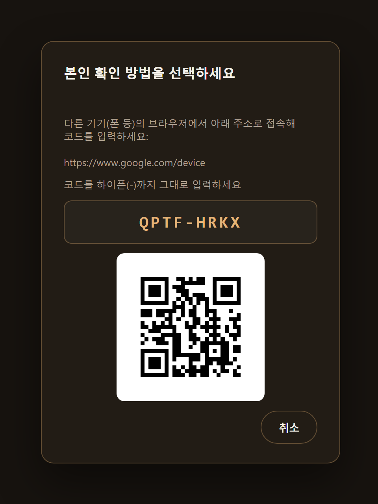
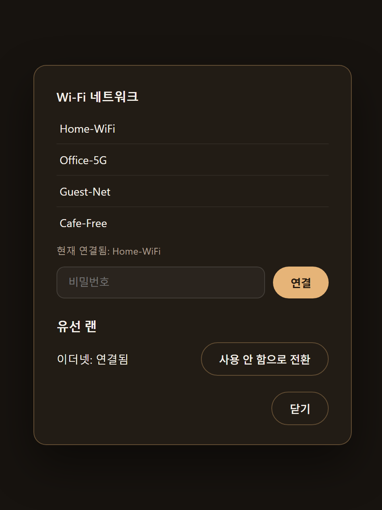
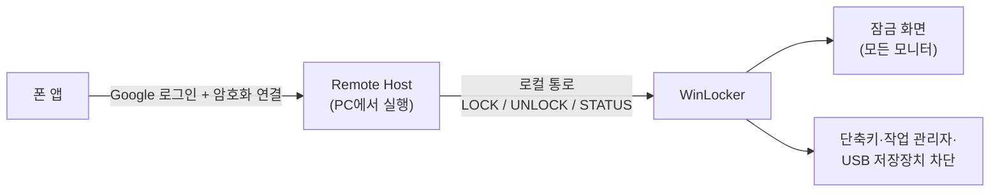

<p align="center">
  
</p>

<p align="center">
  <a href="https://github.com/BlackBuddle/WinLocker-releases/releases/latest"></a>
  
  
</p>

<p align="center">
  공유 시설에 둔 개인 PC를 자체 잠금 화면으로 덮고, 폰에서 원격으로 잠그고 푸는 Windows 잠금 프로그램입니다.
</p>

<p align="center">
  <a href="https://github.com/BlackBuddle/WinLocker-releases/releases/latest/download/WinLocker-win-x64.zip"><b>최신 버전 내려받기 (WinLocker-win-x64.zip)</b></a>
  &nbsp;·&nbsp;
  <a href="https://github.com/BlackBuddle/WinLocker-releases/releases">모든 릴리스</a>
</p>

이 저장소에는 소스 코드가 없고 배포용 실행 파일(릴리스)만 올라옵니다. 설치된 WinLocker의 자동
업데이트도 이 저장소의 최신 릴리스를 확인합니다.

## 화면

<table>
  <tr>
    <td colspan="2" align="center">
      <br>
      <sub>잠금 화면 — 모든 모니터를 덮고, 하단에 Wi-Fi·원격 제어 상태를 보여 줍니다</sub>
    </td>
  </tr>
  <tr>
    <td align="center" width="50%">
      <br>
      <sub>트레이 카드 — 해제 상태에서 트레이 아이콘을 우클릭</sub>
    </td>
    <td align="center" width="50%">
      <br>
      <sub>상태·진단 — 버전, 원격 연결, 자동 시작, 업데이트</sub>
    </td>
  </tr>
  <tr>
    <td align="center">
      <br>
      <sub>비밀번호 재설정 — Google 계정으로 본인 확인(QR)</sub>
    </td>
    <td align="center">
      <br>
      <sub>네트워크 설정 — 잠긴 화면에서 Wi-Fi·유선 랜 연결</sub>
    </td>
  </tr>
</table>

<sub>화면은 예시 데이터로 그린 것입니다.</sub>

## 무엇을 하나요

- **재부팅해도 곧바로 잠깁니다.** 자동 로그온 뒤 스스로 떠서 모든 모니터를 덮고, 창 전환 단축키와
  작업 관리자, USB 저장장치를 막습니다.
- **폰에서 잠그고 풉니다.** PC에서 도는 Remote Host가 인증한 요청만 같은 Windows 계정의 로컬
  통로로 받습니다.
- **원격이 안 될 때도 풀 수 있습니다.** 잠금 화면에서 로컬 비밀번호를 입력하거나, 비밀번호를
  잊었으면 Google 계정 재인증으로 새 비밀번호를 정합니다.
- **스스로를 점검합니다.** 잠긴 동안 30초마다 보호를 다시 적용하고, 일부가 실패하면 화면 하단에
  알립니다. 잠긴 동안 모니터를 꽂거나 빼도 1초 안팎에 다시 덮습니다.
- **해제 상태에서는 트레이 카드**로 지금 잠그기, 네트워크 설정, 상태·진단, 완전 종료를 바로 씁니다.
- **자동으로 업데이트됩니다.** 새 릴리스를 받아 두었다가 다음에 잠글 때 교체합니다.

## 어떻게 동작하나요



재부팅하면 Windows 로그인 화면에서는 원격 도구가 입력을 넣을 수 없습니다. 그래서 WinLocker는
자동 로그온으로 그 화면을 건너뛰고, 그 위에 자체 잠금 화면을 띄워 폰에서 풀 수 있게 합니다.
원격 인증은 별도 프로그램인 Remote Host가 맡고, WinLocker는 같은 PC 안에서 잠금·해제 신호만
받습니다.

## 실행 요구 사항

- Windows 10/11 x64, 관리자 권한
- [.NET 8 런타임](https://dotnet.microsoft.com/download/dotnet/8.0)(Microsoft.NETCore.App 8.0 이상)
- WebView2 런타임 — Windows 10/11에는 보통 설치돼 있고, 없으면 잠금 화면이 기본 모양으로 뜹니다.

## 설치

1. [최신 릴리스](https://github.com/BlackBuddle/WinLocker-releases/releases/latest)에서
   `WinLocker-win-x64.zip`과 `WinLocker-win-x64.zip.sha256`을 받습니다.
2. 받은 zip이 손상되지 않았는지 확인합니다. 아래 값이 `.sha256` 파일 내용과 같아야 합니다.
   ```powershell
   (Get-FileHash .\WinLocker-win-x64.zip -Algorithm SHA256).Hash
   ```
3. zip을 설치 폴더에 풉니다. 일반 사용자가 쓸 수 없는 폴더(예: `C:\Program Files\WinLocker`)를
   권장합니다.
4. 관리자 권한으로 `WinLocker.exe --install-autostart`를 실행해 로그온 때 자동으로 뜨게 합니다.
   예전 버전에서 등록했다면 한 번 더 실행해야 새 작업 설정이 반영됩니다.
5. 처음 실행하면 로컬 비밀번호와 Google 계정을 설정하는 창이 뜹니다.

디스크 암호화(BitLocker)와 자동 로그온을 먼저 설정해야 안전하게 쓸 수 있습니다.

## 자동 업데이트

- 잠금을 해제할 때 이 저장소의 최신 릴리스를 확인합니다(최소 6시간 간격). 초안과 프리릴리스는
  무시합니다.
- 새 버전이 있으면 뒤에서 받아 해시와 파일 버전을 확인한 뒤 보관해 둡니다.
- 다음에 잠글 때, 화면을 끝까지 잠근 뒤 업데이터가 설치 폴더를 새 버전으로 바꾸고 WinLocker를
  다시 띄웁니다. 이 동안 약 1초 화면이 잠기지 않습니다.
- 드라이브 루트(`C:\`)에 설치했거나 업데이터가 없는 설치본은 자동 업데이트를 하지 않습니다.

## 알려진 한계

- Ctrl+Alt+Del은 Windows가 보호하는 키라 막을 수 없습니다.
- 자동 업데이트로 교체하는 동안 약 1초 화면이 잠기지 않습니다.
- WinLocker가 비정상 종료되면 다음 로그온까지 다시 뜨지 않습니다.

## 라이선스

© 2026 BlackBuddle. All rights reserved. 저작권자의 사전 서면 허락 없이 이 소프트웨어를 사용,
복제, 수정, 배포할 수 없습니다. 전문은 [`LICENSE.txt`](LICENSE.txt)와 각 릴리스 zip 안의
`LICENSE.txt`에 있습니다.

릴리스 zip에 들어 있는 제3자 구성 요소(Microsoft Edge WebView2 SDK)의 라이선스와 고지문은 zip 안의
`THIRD-PARTY-NOTICES.txt`에 있습니다.

<details>
<summary><b>릴리스 올리는 규칙 (관리용)</b></summary>

<br>

자동 업데이트가 아래 이름과 형식을 그대로 찾으므로 정확히 맞춰야 합니다.

- 태그는 `vX.Y.Z` 형식이고, 초안이나 프리릴리스가 아닌 **정식 릴리스**로 게시합니다
  (`releases/latest`가 정식 릴리스만 돌려줍니다).
- 자산은 다음 두 개입니다.
  - `WinLocker-win-x64.zip` — WinLocker와 WinLockerUpdater를 같은 폴더에 `dotnet publish`한
    결과. `WinLocker.exe`, `WinLockerUpdater.exe`, `LICENSE.txt`, `THIRD-PARTY-NOTICES.txt`가
    압축 루트에 있어야 합니다.
  - `WinLocker-win-x64.zip.sha256` — 위 zip의 SHA-256 해시(16진수 문자열만, 다른 내용 없이).
- `WinLocker.exe`의 파일 버전이 태그와 같아야 합니다(`-p:Version=X.Y.Z`). 다르면 업데이트가 그
  릴리스를 거부합니다.
- 게시는 Windows에서 합니다. 다른 OS에서 게시하면 파일 버전 정보가 비어 거부됩니다.

</details>
