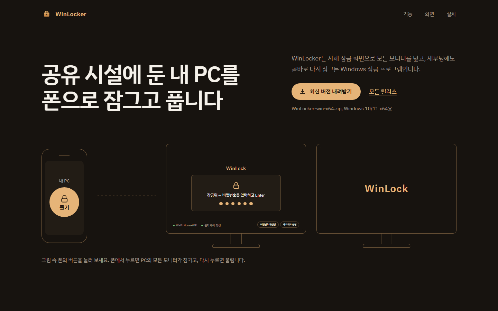
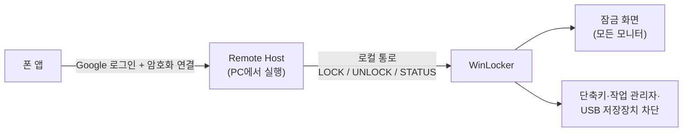

<p align="center">
  
</p>

<p align="center">
  <a href="https://blackbuddle.github.io/WinLocker-releases/"></a><br>
  <a href="https://blackbuddle.github.io/WinLocker-releases/"><b>소개 페이지 보기</b></a><br>
  <sub>기능마다 움직이는 그림으로 설명합니다</sub>
</p>

<p align="center">
  <a href="https://github.com/BlackBuddle/WinLocker-releases/releases/latest"></a>
  
  
</p>

<p align="center">
  공유 시설에 둔 개인 PC를 자체 잠금 화면으로 덮고, 폰에서 원격으로 잠그고 푸는 Windows 잠금 프로그램입니다.
</p>

<p align="center">
  <a href="https://github.com/BlackBuddle/WinLocker-releases/releases/latest/download/WinLocker-win-x64.zip"><b>최신 버전 내려받기 (WinLocker-win-x64.zip)</b></a>
  &nbsp;·&nbsp;
  <a href="https://github.com/BlackBuddle/WinLocker-releases/releases">모든 릴리스</a>
</p>

이 저장소에는 소스 코드가 없고 배포용 실행 파일(릴리스)만 올라옵니다. 설치된 WinLocker의 자동
업데이트도 이 저장소의 최신 릴리스를 확인합니다.

## 화면

<table>
  <tr>
    <td colspan="2" align="center">
      <br>
      <sub>잠금 화면 — 모든 모니터를 덮고, 하단에 Wi-Fi·원격 제어 상태를 보여 줍니다</sub>
    </td>
  </tr>
  <tr>
    <td align="center" width="50%">
      <br>
      <sub>트레이 카드 — 해제 상태에서 트레이 아이콘을 우클릭</sub>
    </td>
    <td align="center" width="50%">
      <br>
      <sub>상태·진단 — 버전, 원격 연결, 자동 시작, 업데이트</sub>
    </td>
  </tr>
  <tr>
    <td align="center">
      <br>
      <sub>비밀번호 재설정 — Google 계정으로 본인 확인(QR)</sub>
    </td>
    <td align="center">
      <br>
      <sub>네트워크 설정 — 잠긴 화면에서 Wi-Fi·유선 랜 연결</sub>
    </td>
  </tr>
</table>

<sub>화면은 예시 데이터로 그린 것입니다.</sub>

## 무엇을 하나요

- **재부팅해도 곧바로 잠깁니다.** 자동 로그온 뒤 스스로 떠서 모든 모니터를 덮고, 창 전환 단축키와
  작업 관리자, USB 저장장치를 막습니다.
- **폰에서 잠그고 풉니다.** PC에서 도는 Remote Host가 인증한 요청만 같은 Windows 계정의 로컬
  통로로 받습니다.
- **원격이 안 될 때도 풀 수 있습니다.** 잠금 화면에서 로컬 비밀번호를 입력하거나, 비밀번호를
  잊었으면 Google 계정 재인증으로 새 비밀번호를 정합니다.
- **스스로를 점검합니다.** 잠긴 동안 30초마다 보호를 다시 적용하고, 일부가 실패하면 화면 하단에
  알립니다. 잠긴 동안 모니터를 꽂거나 빼도 1초 안팎에 다시 덮습니다.
- **해제 상태에서는 트레이 카드**로 지금 잠그기, 네트워크 설정, 상태·진단, 완전 종료를 바로 씁니다.
- **자동으로 업데이트됩니다.** 새 릴리스를 받아 두었다가 다음에 잠글 때 교체합니다.

## 어떻게 동작하나요



재부팅하면 Windows 로그인 화면에서는 원격 도구가 입력을 넣을 수 없습니다. 그래서 WinLocker는
자동 로그온으로 그 화면을 건너뛰고, 그 위에 자체 잠금 화면을 띄워 폰에서 풀 수 있게 합니다.
원격 인증은 별도 프로그램인 Remote Host가 맡고, WinLocker는 같은 PC 안에서 잠금·해제 신호만
받습니다.

## 용도

WinLocker는 **PC 주인이 자기 PC에 직접 설치해 쓰는** 잠금 프로그램입니다.

- 설치와 자동 시작 등록에는 관리자 권한이 필요합니다. 스스로 설치되거나 다른 PC로 옮겨 가는
  기능은 없습니다.
- 잠금은 폰 앱, 로컬 비밀번호, 본인 Google 계정 재인증 중 하나로 풀고, [제거](#제거) 순서대로
  언제든 완전히 지울 수 있습니다.
- 다른 사람이 쓰는 PC에는 그 사람의 동의 없이 설치하지 마세요.
- 있는 그대로 무료로 제공하며, 모든 우회를 막는다고 보증하지 않습니다. 설치 전에
  [알려진 한계](#알려진-한계)와 [라이선스](#라이선스)의 책임 제한을 읽어 주세요.

## 실행 요구 사항

- Windows 10/11 x64, 관리자 권한
- [.NET 8 런타임](https://dotnet.microsoft.com/download/dotnet/8.0)(Microsoft.NETCore.App 8.0 이상)
- WebView2 런타임 — Windows 10/11에는 보통 설치돼 있고, 없으면 잠금 화면이 기본 모양으로 뜹니다.

## 설치

1. [최신 릴리스](https://github.com/BlackBuddle/WinLocker-releases/releases/latest)에서
   `WinLocker-win-x64.zip`과 `WinLocker-win-x64.zip.sha256`을 받습니다.
2. 받은 zip이 손상되지 않았는지 확인합니다. 아래 값이 `.sha256` 파일 내용과 같아야 합니다.
   ```powershell
   (Get-FileHash .\WinLocker-win-x64.zip -Algorithm SHA256).Hash
   ```
3. zip을 설치 폴더에 풉니다. 일반 사용자가 쓸 수 없는 폴더(예: `C:\Program Files\WinLocker`)를
   권장합니다.
4. 관리자 권한으로 `WinLocker.exe --install-autostart`를 실행해 로그온 때 자동으로 뜨게 합니다.
   예전 버전에서 등록했다면 한 번 더 실행해야 새 작업 설정이 반영됩니다.
5. 처음 실행하면 로컬 비밀번호와 Google 계정을 설정하는 창이 뜹니다.

디스크 암호화(BitLocker)와 자동 로그온을 먼저 설정해야 안전하게 쓸 수 있습니다.

## 자동 업데이트

- 잠금을 해제할 때 이 저장소의 최신 릴리스를 확인합니다(최소 6시간 간격). 초안과 프리릴리스는
  무시합니다.
- 새 버전이 있으면 뒤에서 받아 해시와 파일 버전을 확인한 뒤 보관해 둡니다.
- 다음에 잠글 때, 화면을 끝까지 잠근 뒤 업데이터가 설치 폴더를 새 버전으로 바꾸고 WinLocker를
  다시 띄웁니다. 이 동안 약 1초 화면이 잠기지 않습니다.
- 드라이브 루트(`C:\`)에 설치했거나 업데이터가 없는 설치본은 자동 업데이트를 하지 않습니다.

## 설치하면 바뀌는 것

| 바뀌는 것 | 언제 | 되돌리기 |
|---|---|---|
| 예약된 작업 `WinLocker` — 로그온 때 가장 높은 권한으로 실행 | `--install-autostart`를 실행할 때 | `--uninstall-autostart` |
| 작업 관리자 차단 — `HKCU\Software\Microsoft\Windows\CurrentVersion\Policies\System`의 `DisableTaskMgr` = 1 | 잠긴 동안 | 잠금을 풀면 값을 지웁니다 |
| USB 저장장치 차단 — `HKLM\SYSTEM\CurrentControlSet\Services\USBSTOR`의 `Start` = 4 | 잠긴 동안 | 잠금을 풀면 3(Windows 기본값)으로 되돌립니다 |
| 창 전환 단축키 차단 | 잠긴 동안 | 잠금을 풀면 풀립니다 |
| 설정·기록 폴더 `%LOCALAPPDATA%\WinLocker` — 로컬 비밀번호 해시, Google 계정 설정, 로그, WebView2 데이터, 업데이트 기록과 임시 파일 | 처음 실행할 때부터 | 직접 지웁니다 |
| 인터넷 연결 — GitHub(이 저장소의 업데이트 확인·내려받기), Google 인증 서버(Google 계정으로 비밀번호를 재설정할 때) | 해제할 때(최소 6시간 간격), 재설정할 때 | — |

## 제거

1. 잠금을 풉니다. 풀면 작업 관리자·USB 저장장치 차단이 원래대로 돌아갑니다.
2. 관리자 권한 PowerShell에서 자동 시작 등록을 해제합니다. 설치 폴더가 다르면 경로를 바꿉니다.
   ```powershell
   & "C:\Program Files\WinLocker\WinLocker.exe" --uninstall-autostart
   ```
3. 트레이 아이콘을 우클릭해 **종료**를 누르고, 확인 창에서 **예**를 누릅니다.
4. 설치 폴더(예: `C:\Program Files\WinLocker`)를 지웁니다.
5. 설정·기록 폴더 `%LOCALAPPDATA%\WinLocker`를 지웁니다. 로컬 비밀번호 해시와 Google 계정 설정도
   함께 지워집니다.
6. `%TEMP%`에 `WinLockerUpdater-`로 시작하는 폴더가 남아 있으면 지웁니다.
7. WinLocker 때문에 켠 자동 로그온은 끕니다. 켜 둔 채로 두면 PC가 잠금 없이 바로 열립니다.
8. Remote Host는 별도 프로그램이라 따로 지웁니다.

잠긴 채로 비정상 종료돼 작업 관리자나 USB 저장장치가 계속 막혀 있으면, WinLocker를 다시 실행해
잠금을 풀면 돌아옵니다. WinLocker를 이미 지웠다면 WinLocker를 쓰던 계정에서 관리자 권한
PowerShell을 열고 다음을 실행합니다.

```powershell
Remove-ItemProperty 'HKCU:\Software\Microsoft\Windows\CurrentVersion\Policies\System' -Name DisableTaskMgr -ErrorAction SilentlyContinue
Set-ItemProperty 'HKLM:\SYSTEM\CurrentControlSet\Services\USBSTOR' -Name Start -Value 3
```

## 알려진 한계

- Ctrl+Alt+Del은 Windows가 보호하는 키라 막을 수 없습니다.
- 자동 업데이트로 교체하는 동안 약 1초 화면이 잠기지 않습니다.
- WinLocker가 비정상 종료되면 다음 로그온까지 다시 뜨지 않습니다.

## 보안 문제 신고

잠금 우회 같은 보안 문제는 공개 이슈 대신 [`SECURITY.md`](SECURITY.md)에 적힌 방법으로 알려 주세요.

## 라이선스

**개인 사용은 무료입니다.** 자기 PC에 설치해 쓰는 데에는 따로 허락이 필요 없습니다. 다음은
저작권자의 사전 서면 허락이 필요하며, 문의는 [Issues](https://github.com/BlackBuddle/WinLocker-releases/issues)로
해 주세요.

- 회사·기관·단체·매장 등 조직의 PC에 설치하는 업무용 사용
- 재배포(공식 배포처 링크를 알려 주는 것은 괜찮습니다)
- 수정, 역설계, 2차 저작물 작성
- 판매, 대여, 유료 제공

**책임 제한.** WinLocker는 있는 그대로 무료로 제공되며, 모든 무단 접근이나 우회를 막는다고
보증하지 않습니다. 관련 법이 허용하는 한도에서, 잠금 우회·데이터 유출이나 손실 같은 보안상 사고를
포함해 사용으로 생긴 손해에 책임지지 않습니다(저작권자의 고의·중대한 과실은 제외).

전문은 [`LICENSE.txt`](LICENSE.txt)에 있고, 이 저장소에서 배포한 모든 버전에 적용됩니다. v1.0.0 zip
안의 `LICENSE.txt`는 예전 문구이며, 이 저장소의 `LICENSE.txt`가 우선합니다.
© 2026 BlackBuddle. All rights reserved.

릴리스 zip에 들어 있는 제3자 구성 요소(Microsoft Edge WebView2 SDK)의 라이선스와 고지문은 zip 안의
`THIRD-PARTY-NOTICES.txt`에 있습니다.

<details>
<summary><b>릴리스 올리는 규칙 (관리용)</b></summary>

<br>

자동 업데이트가 아래 이름과 형식을 그대로 찾으므로 정확히 맞춰야 합니다.

- 태그는 `vX.Y.Z` 형식이고, 초안이나 프리릴리스가 아닌 **정식 릴리스**로 게시합니다
  (`releases/latest`가 정식 릴리스만 돌려줍니다).
- 자산은 다음 두 개입니다.
  - `WinLocker-win-x64.zip` — WinLocker와 WinLockerUpdater를 같은 폴더에 `dotnet publish`한
    결과. `WinLocker.exe`, `WinLockerUpdater.exe`, `LICENSE.txt`, `THIRD-PARTY-NOTICES.txt`가
    압축 루트에 있어야 합니다.
  - `WinLocker-win-x64.zip.sha256` — 위 zip의 SHA-256 해시(16진수 문자열만, 다른 내용 없이).
- `WinLocker.exe`의 파일 버전이 태그와 같아야 합니다(`-p:Version=X.Y.Z`). 다르면 업데이트가 그
  릴리스를 거부합니다.
- 게시는 Windows에서 합니다. 다른 OS에서 게시하면 파일 버전 정보가 비어 거부됩니다.

</details>
